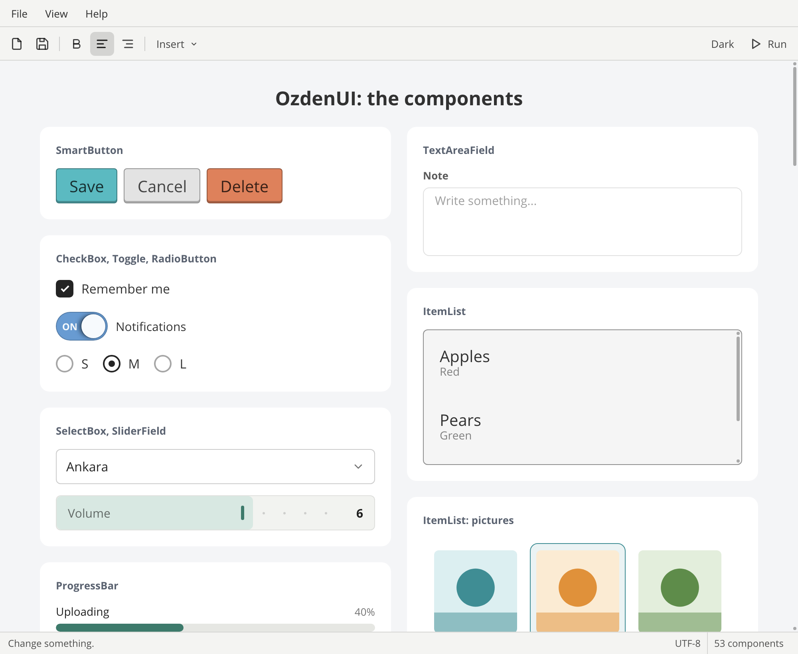

<p align="center">
  <picture>
    <source media="(prefers-color-scheme: dark)" srcset="images/ozdenui-ruby-dark.svg">
    
  </picture>
</p>

# OzdenUI for Ruby

A small, modern window of its own in Ruby, made of [basic.js](https://bug7a.github.io/basic.js/) objects and the
components of the OzdenUI kit. Only Ruby: no JavaScript, no HTML, no CSS, no build step of a front end, **no other gem
and no compiler**. Your Ruby code makes the objects, and a window shows them.

<p align="center">
  
</p>

The window above is [examples/gallery.rb](examples/gallery.rb), the main components of the kit in one window.

```ruby
require "ozdenui"
include OzdenUI

@count = 0

def add(step)
  @count += step
  @label.text = @count.to_s
end

run(title: "Counter", width: 360, height: 260) do |page|
  page.color = "#F4F5F7"
  VGroup(gap: 16) do
    @label = Label(text: "0", font_size: 48)
    HGroup(hug: true, gap: 10) do
      SmartButton(label_text: "Minus", on_click: -> { add(-1) })
      SmartButton(label_text: "Plus", tone: "cyan", on_click: -> { add(1) })
    end
  end
end
```

```
gem install ozdenui
ruby counter.rb
```

v0.1, experimental: made and tested on macOS; Windows and Linux use the window of Edge or Chrome and are checked by
the tests of the repository, not yet by hand. Ruby 2.6 or newer.

- **macOS:** the window is the web view of the system (WKWebView), inside the program, made with `fiddle`, the
  library of Ruby that calls the system. Nothing to install: it works with the Ruby that comes with macOS
  (`/usr/bin/ruby`).
- **Windows, Linux:** the window is an app window of Edge or Chrome (no address bar, no tabs): nothing to install on
  Windows, where Edge is always there.

**With an AI assistant** (Claude Code, Codex, Cursor, Copilot...): OzdenUI is new, so an assistant does not know it
yet. One command writes its rules (how a program is made, the layout, the events, the components, the mistakes to
avoid) into the folder of your project, where the assistant reads them by itself:

```
ozdenui agents              # into AGENTS.md
ozdenui agents CLAUDE.md    # into another file
```

And the assistant can look at the window it made, without a window:

```
OZDENUI_LOOK=app.png ruby app.rb    # runs the program as it is, saves a picture of its window, ends
```

## How it works

- The window shows a page of basic.js that is inside the gem, served only to this computer.
- An object in Ruby is a proxy: it keeps an id and the values it was given, and sends commands to the page, where the
  real basic.js object lives. The events of the page come back as calls of your blocks.
- Everything of your program runs on one thread, one task at a time (the block of `run`, an event, a timer): no
  locks. The commands of a task go to the page together, when the task ends.
- Reading a value the program gave, or the state a component tells (the text of a field, a checked box), asks nothing
  of the page.

## Objects

`include OzdenUI` gives the short names; without it they are methods of the module (`OzdenUI.Label(...)`,
`OzdenUI.run`). Five plain objects and two groups:

```ruby
Box(20, 20, 200, 120, color: "white", round: 8) do           # left, top, width, height
  Label(12, 12, text: "In the box")                          # a place of its own in a Box
end
VGroup(gap: 12, padding: 20, align: "left top") do           # one under the other
  Label(text: "A name", font_size: 15)
  Input(width: 220, placeholder: "Type here", on_enter: method(:save))
  Button(text: "Save", on_click: method(:save))
  Icon(width: 48, height: 48, picture: "photo.png")
end
```

- The names are the names of basic.js and the kit, in snake_case: `fontSize` is `font_size:`, `onClick` is `on_click:`.
- A value that is not written keeps the default of basic.js. A size is a number (px) or a text (`"100%"`, `"auto"`).
  `text:` is shown as it is written; `html:` takes HTML.
- A group is 100% x 100%; `hug: true` wraps its objects, `fill: true` takes the room the others leave.
- Later: `label.text = "Hi"`, `label.set(text: "Hi", font_size: 20)`, `label.text`, `obj.hide`, `obj.show`,
  `obj.remove`, `box.add { ... }` to make more objects in a box.
- Events: `on_click:`, `on_input:`, `on_enter:`, `on_key_down:`..., or `obj.on(:dblclick) { |obj, event| ... }`; a
  handler is a lambda, a method or a block that takes what it needs: `-> { }`, `->(obj) { }`, `->(obj, event) { }`.

## Components

Every component of the kit is a method of its name; its params are the params of the kit in snake_case.
`ozdenui doc SelectBox` prints them in the terminal, each with its default
([all of them](lib/ozdenui/COMPONENTS.md)).

```ruby
name = TextField(title_text: "Name", width: 260, on_enter: method(:save))
color = SelectBox(options: %w[Red Green Blue], value: "Green")
agree = CheckBox(label_text: "I agree", on_change: ->(box) { puts box.checked? })
SmartButton(label_text: "Save", tone: "cyan", on_click: lambda {
  puts name.text, color.value, agree.checked?        # read without a question to the page
})
```

| For | Methods |
|---|---|
| Buttons | `SmartButton`, `ActionButton`, `HoldToConfirmButton` |
| Fields | `TextField`, `EmailField`, `PasswordField`, `NumberField`, `CurrencyField`, `PhoneField`, `UrlField`, `TextAreaField`, `SearchInput`, `TagInput` |
| Choices | `CheckBox`, `Toggle`, `RadioButton`, `SelectBox`, `TinySelect`, `Slider`, `SliderField`, `RangeSlider`, `Stepper`, `DatePicker`, `TimePicker`, `ColorPicker` |
| Lists and tables | `ItemList`, `SortableList`, `TreeView`, `SmartTable`, `DataTable`, `TinyTable` |
| Areas that hold objects | `ScrollArea`, `GridGroup`, `Tabs`, `Accordion`, `Splitter`, `SidePanel` |
| Bars | `MenuBar`, `ToolBar`, `StatusBar`, `ContextMenu`, `AppBar`, `BottomBar`, `Breadcrumbs` |
| Messages | `Tooltip`, `LoadingScreen`, `ProgressBar`, `LineProgressBar`, `StepBar`, `Notice`, `Badge` |
| Views | `GraphBox`, `MiniGraphBox`, `SparkLineBox`, `Gauge`, `LogView`, `ImageView`, `MarkdownView`, `JsonView`, `JsonEditor`, `CodeEditor`, `RichTextEditor`, `Canvas`, `ChatView`, `WebView`, `FilePicker`, `TimeLine` |

- A callback gets the object and the values the kit names: `on_select: ->(table, row) { puts row[:name] }`.
- A row of a table and an item of a list are Hashes: `{ key: "tr", text: "Türkiye" }`. Inside them the keys go to the
  page as they are written, so a key of the kit is written as the kit writes it (`iconFile:`). What comes back from
  the page is read with a text or a symbol: `row["name"]`, `row[:name]`.
- The areas: `ScrollArea(...) { ... }`, `GridGroup(columns: 3) { ... }`, `tabs.panel(key) { ... }`,
  `accordion.section(key) { ... }`, `splitter.first { ... }` / `splitter.second { ... }`, `panel.body { ... }`.
- Later: `gauge.unit_text = "kg"` changes a param (with the method of the kit when it has one; the callback of the
  component is not called by a change of the code); a method of the kit is a method of the object:
  `list.add_item(key: "a", text: "A")`, and one that starts with `get_`, `is_` or `has_` returns its result
  (`list.get_selected_keys`).
- A component is loaded into the page when the program first names it, with what it needs: a program pays only for
  what it uses.
- Any component by its name: `component("Gauge", value: 72)`.

## Dialogs and messages

```ruby
delete_list if confirm("Delete the list?", danger: true)    # waits; the window keeps working
name = prompt("The name of the list:")                      # nil: cancelled
alert("Saved.")
case ask("Save the changes?", "Save", "Don't save", "Cancel")
when "Save" then save
end
toast("Saved.")                                             # never waits; type: :error, :warning, :info
path = open_file(types: %w[csv])                            # the file dialog of the system
```

## Time and threads

```ruby
timer = every(1000) { tick }        # again and again; timer.stop ends it
after(3000) { close }               # once

Thread.new do                       # a slow job: the window does not wait for it
  text = download
  ui { @label.text = text }         # the objects are changed on the thread of the window
end
```

An object changed from another thread raises with this fix in its message; nothing breaks without a word.

## Light, dark, minimal

```ruby
run(theme: "dark") { ... }                               # "light", "dark", "auto"
run(style: "minimal", accent: "#2A78D6") { ... }         # small, made of lines, one color
```

`run(language: "tr")` is the language of the texts of the window (capital letters, word breaks).

In a dark window every component takes its dark look by itself, and the plain objects and the page are dark too.
`set_theme("dark")` changes it while the program runs (the block of `run` runs again). One component:
`style_name: "..."` (`ozdenui doc` names its packages) or `style: { box: { round: 12 } }`.

## Examples

`ruby -Ilib examples/gallery.rb` (from a clone of the repository):

| | |
|---|---|
| `counter`, `greeting`, `basics` | the first steps |
| `notes`, `todo`, `form`, `settings`, `calculator` | small programs |
| `dialogs`, `charts`, `clock`, `game` | dialogs, charts, timers, a Box with places and keys |
| `csv_viewer`, `json_viewer`, `image_viewer`, `editor`, `markdown_editor` | files of the computer |
| `job_log` | a thread that tells its progress |
| `chat`, `gallery`, `minimal_theme` | the bigger ones |

## Limits of v0.1

- macOS is the tested system. Windows and Linux open the app window of Edge or Chrome (with none of them: a tab of
  the default browser); the web view of the system there is a later step.
- On macOS the menu bar names the program by the title of its window, but the Dock shows it as a Ruby program (it is
  not an app bundle).
- One window for a program.
- A callback of the kit that must answer at once (a validator, `createItemView`) can not be a block of the program:
  the answer of the program comes after the page has drawn.
- A file dropped on a `FilePicker` gives its name, not its path on the computer; a click on it opens the file dialog
  of the system, and those files have their paths (`picker.paths`).
- With Bundler on Ruby 3.5 or newer, add `gem "fiddle"` to the Gemfile (it left the default gems); without it the
  window of macOS is the window of a browser.
- No hot reload: `ruby app.rb` again.

## Development

```
ruby test/ozdenui_test.rb        # the checks; test_window plays a real page in a hidden Chrome
checks/look-all.sh               # a picture of every example, light and dark (pictures/)
./update-web.sh --commit HEAD    # the kit copy (lib/ozdenui/web) from the js-components repository, then kit.json
ruby tools/gen.rb                # kit.json and COMPONENTS.md again, after a change of tools/spec.json
gem build ozdenui.gemspec
```

`lib/ozdenui/kit.json` (the table of the components) and `lib/ozdenui/COMPONENTS.md` are written by `tools/gen.rb`
from the files of the kit in `lib/ozdenui/web/comp` and from `tools/spec.json`; never edit them by hand, and never
edit the copy in `lib/ozdenui/web/basic` and `lib/ozdenui/web/comp`.

The family: [OzdenUI for Python](https://github.com/bug7a/ozdenui-python) and
[OzdenUI for Go](https://github.com/bug7a/ozdenui-go) are the same kit for Python and Go;
[basic.js](https://bug7a.github.io/basic.js/) and the [components](https://bug7a.github.io/js-components/) are the
JavaScript they stand on.

## License

Apache 2.0. Copyright 2026 Buğra Özden. basic.js and the components of the kit are in `lib/ozdenui/web/` (Apache 2.0,
the same author).

Developed with the help of Claude Code (Anthropic).
